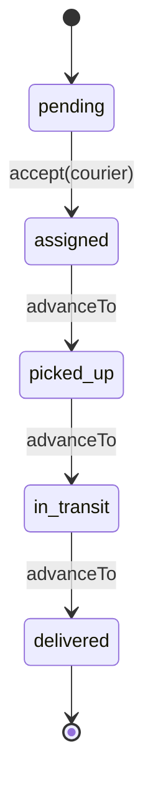
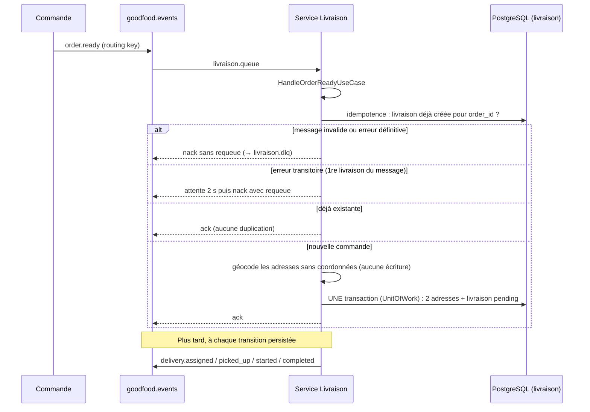

# Architecture

## Les 4 couches et la règle de dépendance

```
presentation  →  application  →  domain
infrastructure ↗
```

- **domain** : TypeScript pur (aucun import `@nestjs/*`, `typeorm`, `amqplib`). Entités avec
  comportement (`Delivery`, `Address`), value objects (`GeoPoint`), services de domaine
  (`EtaCalculator`), ports (interfaces) et erreurs métier.
- **application** : un use case = une classe avec `execute(input)`. Ne connaît que le domaine
  et les ports. Seuls `@Injectable()`/`@Inject(TOKEN)` de Nest sont tolérés.
- **infrastructure** : adaptateurs qui implémentent les ports (TypeORM, RabbitMQ, Nominatim,
  horloge, générateur d'id).
- **presentation** : contrôleurs fins, DTO, guards, filtre d'exceptions.

La règle est outillée : une règle ESLint `no-restricted-imports` fait échouer le lint si
`domain/` importe un framework ou si `application/` importe `typeorm`/`amqplib`/`express`/`pg`.

## Cycle de vie d'une livraison



Règles portées par l'entité `Delivery` (pas par les use cases) :
- `accept` : uniquement depuis `pending`, sinon `DeliveryAlreadyAssignedError` (409). Une
  course simultanée entre deux livreurs est tranchée par le verrou optimiste (`version`) en
  persistance.
- `advanceTo` : seule la transition suivante dans la chaîne est valide, et seulement par le
  livreur assigné, sinon `InvalidStatusTransitionError` (409) ou `DeliveryNotFoundError` (404 :
  pour un autre livreur, la livraison « n'existe pas »).
- `updateLocation` : uniquement entre `assigned` et `in_transit`, par le livreur assigné, sinon
  `LocationUpdateNotAllowedError` (409, message dédié si la livraison est terminée) ou
  `DeliveryNotFoundError` (404).
- Chaque étape fige sa date : `acceptedAt`, `pickedUpAt`, `startedAt` (`in_transit`),
  `deliveredAt`. Exposées en `assigned_at`, `picked_up_at`, `started_at`, `completed_at` par
  l'API, et reprises telles quelles comme date des événements `delivery.*`.
- Un livreur ne peut pas dépasser `MAX_ACTIVE_DELIVERIES_PER_COURIER` livraisons actives
  (`assigned`/`picked_up`/`in_transit`), sinon `CourierBusyError` (409).

## Flux order.ready → livraison → évènements delivery.*



Les mises à jour de position GPS ne sont pas publiées (trop fréquentes) : le suivi se fait par
polling de `GET /deliveries/:id`.

## Compromis assumés

- **Pas d'outbox** : la publication d'évènements `delivery.*` est best-effort (log d'avertissement
  si RabbitMQ est injoignable, la requête HTTP ne doit pas échouer). Un pattern outbox
  (table d'évènements + relai transactionnel) garantirait la publication at-least-once ; hors
  scope de ce POC.
- **Dead-letter queue gérée par l'infra** : un message `order.ready` rejeté (`nack` sans
  requeue) part dans `livraison.dlq` (policy `livraison-dlx` de `goodfood-infra`) ; ce repo ne
  déclare rien pour ça.
- **Remise en file en liste blanche** : le consommateur ne remet en file que les erreurs
  d'infrastructure reconnues comme transitoires (`isTransientInfrastructureError` : codes réseau
  `ECONNREFUSED`/`ETIMEDOUT`…, SQLSTATE `08xxx`/`57P0x`/`53300`/`40001`/`40P01`, `23505` pour une
  course entre deux `order.ready`, messages `pg` de connexion coupée). Après 2 s d'attente, et
  une seule fois : un message déjà `redelivered` dont l'erreur persiste part en DLQ. Tout le
  reste (message invalide, adresse non géocodable, TypeError ou autre bug) part directement en
  DLQ. Cela évite la boucle de requeue infinie observée avec un `pickup_address` absent.
  Compromis : un message redélivré pour une autre raison (crash du consommateur avant `ack`)
  n'a plus droit à une remise en file en cas d'erreur transitoire.
- **Haversine plutôt que PostGIS** : la recherche de livraisons disponibles par rayon utilise une
  formule de Haversine en SQL brut avec pré-filtre bounding box, plutôt qu'une extension
  géospatiale dédiée. Suffisant pour le volume d'un POC, mais moins précis et moins performant
  à grande échelle que PostGIS.
- **Suivi par polling plutôt que push** : le client suit sa livraison en interrogeant
  `GET /deliveries/:id` plutôt que via un flux SSE/WebSocket. Une amélioration future
  consisterait à pousser les mises à jour de position en temps réel.
